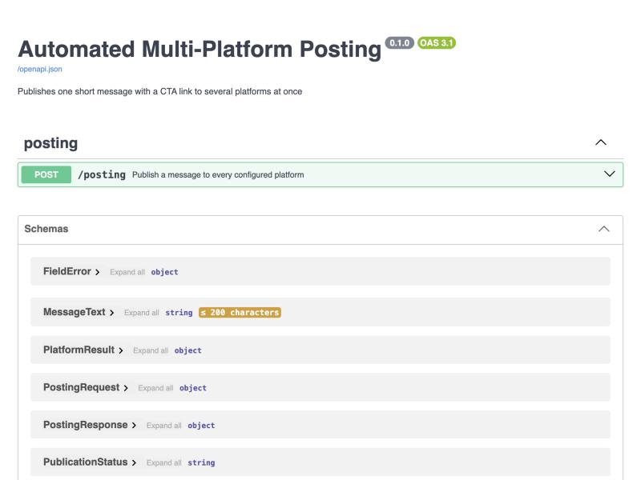

# Automated Multi-Platform Posting

A FastAPI service that takes one short message with a call to action link and publishes it to seven platforms at once through their official APIs. Each platform runs on its own: if one fails, the others still post, and the response reports every platform separately.

| Platform | API | What gets created |
|---|---|---|
| Mastodon | REST `POST /api/v1/statuses` | Public status |
| Telegram | Bot API `sendMessage` | Post in a public channel |
| Bluesky | AT Protocol `com.atproto.repo.createRecord` | `app.bsky.feed.post` with a link facet |
| GitHub Gist | REST `POST /gists` | Public gist |
| DEV Community | Forem API v1 `POST /api/articles` | Published article |
| Telegraph | `createPage` | telegra.ph page |
| Hugging Face | Hub API `POST /api/{type}s/{repo}/discussions` | Discussion on a model, dataset or Space |

Hugging Face covers the "LLM platforms" part of the task. Chat products such as ChatGPT, Claude or Gemini have no public posting API and nothing public to link to, while the Hugging Face Hub is the main public platform of the LLM community and its discussions have public URLs.

## Stack

Python 3.14, FastAPI 0.163, Pydantic 2.14, pydantic-settings 2.16, httpx2 2.16 (the maintained fork of HTTPX from the Pydantic team), Uvicorn 0.54. Tooling: uv, pytest 9, pytest-asyncio, respx, ruff, mypy in strict mode.

## Architecture

Hexagonal architecture with a small DDD core. Dependencies point inward: the domain knows nothing about FastAPI, HTTP or settings.

```text
app/
├── domain/                    Message value object and publication results
├── application/               PostingService and its ports (Publisher, AccessChecker, Clock)
├── infrastructure/
│   ├── http.py                send a request, parse the reply into a model, map failures
│   ├── access_checker.py      opens the post URL without credentials
│   ├── clock.py
│   └── platforms/             one adapter per platform plus the registry
├── api/                       FastAPI router, request and response schemas, error handlers
├── config.py                  settings from environment variables
└── main.py                    composition root and lifespan
```

- **Domain.** `Message` validates itself when it is created, so a `Message` that breaks a rule cannot exist. `PublicationSucceeded` and `PublicationFailed` are separate types, so a failed result can never carry a URL.
- **Application.** `PostingService` starts every publisher in an `asyncio.TaskGroup`, each with its own timeout. Any error turns into a failed result for that platform only. A successful post is then checked for public access.
- **Infrastructure.** Each adapter implements the `Publisher` port. Platform replies are parsed into Pydantic models, and network errors, timeouts and HTTP failures become clear messages such as `Authentication failed (HTTP 401): ...`. A platform with no credentials is replaced by a placeholder that reports `Not configured, set ...`, so the response still lists all seven platforms.
- **Interface.** The request body is parsed straight into the domain `Message` with a Pydantic `PlainValidator`, so the validation rules live in one place. One shared `httpx2.AsyncClient` is created in the lifespan and closed on shutdown.

## Validation rules

- The message is trimmed and must be 1 to 200 characters long.
- It must contain exactly one link. Anything starting with `http://`, `https://` or `www.` counts as a link.
- The link must be an absolute `http` or `https` URL with a real hostname (a dotted name with a valid top level domain, IDN allowed) and no embedded credentials.
- Punctuation right after the link is not part of it, including smart quotes, guillemets and other Unicode punctuation. A closing bracket stays when the link has a matching opener, as in `https://en.wikipedia.org/wiki/Python_(programming_language)`.
- Invisible and control characters such as zero width spaces are rejected, because they can hide a second link inside the first one. Line breaks are allowed.
- Unknown fields are rejected.

Invalid input returns `422`:

```json
{"detail": [{"field": "message", "message": "Message must contain exactly one CTA link, found 2"}]}
```

## Response

`200` when at least one platform published the message, `502` when none did. Both have the same body. `date` and `time` are in UTC.

```json
{
  "success": true,
  "results": [
    {
      "platform": "Mastodon",
      "status": "success",
      "posted_url": "https://mastodon.social/@demo/113523456789012345",
      "public_access": true,
      "date": "2026-11-15",
      "time": "10:21:07",
      "error": null
    },
    {
      "platform": "Telegram",
      "status": "failed",
      "posted_url": null,
      "public_access": false,
      "date": null,
      "time": null,
      "error": "Authentication failed (HTTP 401): Unauthorized"
    }
  ]
}
```

`public_access` comes from an anonymous `GET` of the posted URL after publishing, following redirects. It is `true` only for a `2xx` reply.

## Setup

With uv:

```bash
uv sync
cp .env.example .env
```

With pip:

```bash
python3.14 -m venv .venv && source .venv/bin/activate
pip install -r requirements.txt
cp .env.example .env
```

Fill in `.env` for the platforms you want. Nested settings use a double underscore, for example `MASTODON__ACCESS_TOKEN`. Empty values count as not set.

| Variable | Required | How to get it |
|---|---|---|
| `MASTODON__ACCESS_TOKEN` | yes | On your instance open Preferences, Development, New application, tick `write:statuses`, save and copy "Your access token". |
| `MASTODON__BASE_URL` | no, `https://mastodon.social` | Your instance URL. |
| `TELEGRAM__BOT_TOKEN` | yes | Create a bot with @BotFather (`/newbot`). |
| `TELEGRAM__CHANNEL_USERNAME` | yes | Username of a public channel, with or without `@`. Add the bot as an administrator with the right to post messages. |
| `BLUESKY__HANDLE` | yes | Your handle, for example `name.bsky.social`. |
| `BLUESKY__APP_PASSWORD` | yes | Settings, Privacy and security, App passwords at https://bsky.app/settings/app-passwords. |
| `GITHUB_GIST__TOKEN` | yes | A fine grained token with Gists read and write, or a classic token with the `gist` scope. |
| `DEVTO__API_KEY` | yes | https://dev.to/settings/extensions, "DEV API Keys", Generate API Key. |
| `TELEGRAPH__ACCESS_TOKEN` | yes | `curl "https://api.telegra.ph/createAccount?short_name=posting&author_name=Posting"` and copy `result.access_token`. |
| `TELEGRAPH__AUTHOR_NAME` | no | Author name shown on the page. |
| `HUGGINGFACE__TOKEN` | yes | https://huggingface.co/settings/tokens, a `write` token or a fine grained token that can write discussions on the repository. |
| `HUGGINGFACE__REPO_ID` | yes | A public repository you own with Discussions enabled, for example `name/posting-demo`. |
| `HUGGINGFACE__REPO_TYPE` | no, `space` | `model`, `dataset` or `space`. |
| `PUBLISH_TIMEOUT_SECONDS` | no, `20` | Time limit for one platform. |
| `HTTP_TIMEOUT_SECONDS` | no, `10` | Timeout of a single HTTP call. |
| `ACCESS_CHECK_TIMEOUT_SECONDS` | no, `10` | Timeout of the public access check. |

## Run

```bash
uv run uvicorn app.main:app --host 0.0.0.0 --port 4000
```

API docs: http://localhost:4000/docs

```bash
curl -s -X POST http://localhost:4000/posting \
  -H "Content-Type: application/json" \
  -d '{"message": "Check out our latest business platform and grow your online visibility. https://example.com"}'
```

## Sample run

[docs/sample-run.md](docs/sample-run.md) has the requests, responses and server log of a real local run, and a screenshot of the Swagger UI.



## Tests and checks

```bash
uv run pytest -q
uv run mypy app tests
uv run ruff check .
uv run ruff format --check .
```

The tests do not touch the network. Platform APIs are mocked with respx, and the endpoint is tested in process through `httpx2.ASGITransport` with the posting service replaced through `dependency_overrides`.

## Design decisions

- **No automatic retries of publishing.** Creating a post is not idempotent on most platforms, so a retry after a timeout could post twice. Only connection errors are retried, because no request has been sent yet at that point. Mastodon also gets a random `Idempotency-Key` per publication.
- **A broken access check never breaks a platform result.** If the public access check fails for any reason, the post is reported as published with `public_access: false`, and the other platforms are not affected.
- **The Bluesky session is reused for 60 minutes.** Bluesky allows only 30 logins per 5 minutes for an account, so the adapter logs in once and keeps the session. A rejected post drops the session, so an expired token is replaced on the next post.
- **Bare domains are not counted as links.** `example.com` without a scheme or `www.` is treated as text. Counting it would also reject ordinary words such as `node.js` or `README.md`, and there is no reliable way to tell them apart without a list of every top level domain.
- **`502` when nothing was published.** The example in the task keeps `success: true` when only some platforms fail, so `success` means "at least one platform published". When none did, the request failed as a whole and the status code says so.
- **Not configured platforms stay in the response.** It is better to see `Not configured, set ...` than to wonder why a platform is missing.
- **Time is taken from the platform** when its reply has one (Mastodon, Telegram, GitHub, DEV), otherwise from the server clock at the moment of publishing.
- **Project layout.** The task suggests `app/platforms`, `app/services` and `app/schemas.py`. The same parts exist here as `app/infrastructure/platforms`, `app/application` and `app/api/schemas.py`, split into layers so the business logic does not depend on FastAPI or HTTP.
- **httpx2 instead of httpx.** httpx2 has the same API, and Starlette now recommends it. respx still imports `httpx`, so the tests alias it to httpx2 first (see `docs/lessons.md`).
