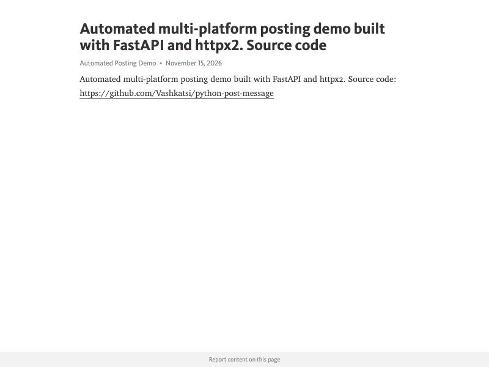
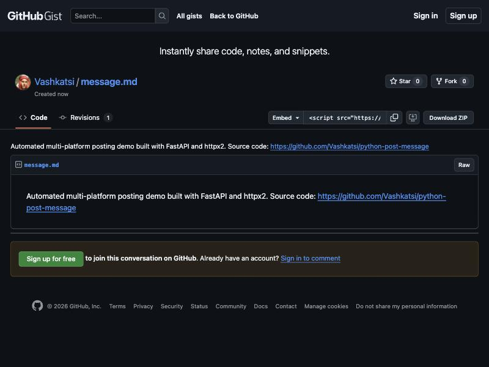
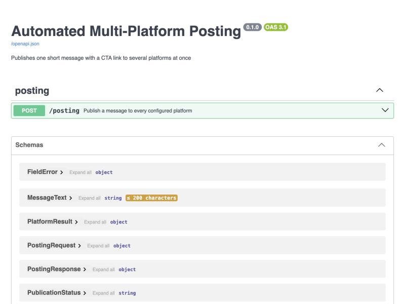

# Sample run

## Live run

A real run with credentials for GitHub Gist and Telegraph in `.env`. Both posts were published and are publicly reachable, and the other platforms report which settings are missing. Because at least one platform published, the status is `200`.

```text
$ curl -s -X POST http://localhost:4000/posting -H "Content-Type: application/json" -d '{"message": "Automated multi-platform posting demo built with FastAPI and httpx2. Source code: https://github.com/Vashkatsi/python-post-message"}'
HTTP 200
```

```json
{
  "success": true,
  "results": [
    {
      "platform": "Mastodon",
      "status": "failed",
      "posted_url": null,
      "public_access": false,
      "date": null,
      "time": null,
      "error": "Not configured, set MASTODON__ACCESS_TOKEN"
    },
    {
      "platform": "Telegram",
      "status": "failed",
      "posted_url": null,
      "public_access": false,
      "date": null,
      "time": null,
      "error": "Not configured, set TELEGRAM__BOT_TOKEN, TELEGRAM__CHANNEL_USERNAME"
    },
    {
      "platform": "Bluesky",
      "status": "failed",
      "posted_url": null,
      "public_access": false,
      "date": null,
      "time": null,
      "error": "Not configured, set BLUESKY__HANDLE, BLUESKY__APP_PASSWORD"
    },
    {
      "platform": "GitHub Gist",
      "status": "success",
      "posted_url": "https://gist.github.com/Vashkatsi/ec675bfce29809a73e94a7e16cf84316",
      "public_access": true,
      "date": "2026-11-15",
      "time": "08:58:37",
      "error": null
    },
    {
      "platform": "DEV Community",
      "status": "failed",
      "posted_url": null,
      "public_access": false,
      "date": null,
      "time": null,
      "error": "Not configured, set DEVTO__API_KEY"
    },
    {
      "platform": "Telegraph",
      "status": "success",
      "posted_url": "https://telegra.ph/Automated-multi-platform-posting-demo-built-with-FastAPI-and-httpx2-Source-code-11-15",
      "public_access": true,
      "date": "2026-11-15",
      "time": "08:58:37",
      "error": null
    },
    {
      "platform": "Hugging Face",
      "status": "failed",
      "posted_url": null,
      "public_access": false,
      "date": null,
      "time": null,
      "error": "Not configured, set HUGGINGFACE__TOKEN, HUGGINGFACE__REPO_ID"
    }
  ]
}
```

```text
INFO:     Started server process [5826]
INFO:     Waiting for application startup.
INFO:     Application startup complete.
INFO:     Uvicorn running on http://127.0.0.1:4000 (Press CTRL+C to quit)
INFO:     127.0.0.1:60442 - "GET /openapi.json HTTP/1.1" 200 OK
INFO:     127.0.0.1:60444 - "POST /posting HTTP/1.1" 200 OK
INFO:     Shutting down
INFO:     Waiting for application shutdown.
INFO:     Application shutdown complete.
INFO:     Finished server process [5826]
```

Published posts:

- GitHub Gist: https://gist.github.com/Vashkatsi/ec675bfce29809a73e94a7e16cf84316
- Telegraph: https://telegra.ph/Automated-multi-platform-posting-demo-built-with-FastAPI-and-httpx2-Source-code-11-15





## Run without credentials

A real local run without any credentials in the environment, so every platform reports what is missing and the service answers 502. With credentials in `.env` the same request publishes to each configured platform.

```text
$ uv run uvicorn app.main:app --host 127.0.0.1 --port 4000
```

### Requests

```text
$ curl -s -X POST http://localhost:4000/posting -H "Content-Type: application/json" -d '{"message": "Check out our latest business platform and grow your online visibility. https://example.com"}'
{"success":false,"results":[{"platform":"Mastodon","status":"failed","posted_url":null,"public_access":false,"date":null,"time":null,"error":"Not configured, set MASTODON__ACCESS_TOKEN"},{"platform":"Telegram","status":"failed","posted_url":null,"public_access":false,"date":null,"time":null,"error":"Not configured, set TELEGRAM__BOT_TOKEN, TELEGRAM__CHANNEL_USERNAME"},{"platform":"Bluesky","status":"failed","posted_url":null,"public_access":false,"date":null,"time":null,"error":"Not configured, set BLUESKY__HANDLE, BLUESKY__APP_PASSWORD"},{"platform":"GitHub Gist","status":"failed","posted_url":null,"public_access":false,"date":null,"time":null,"error":"Not configured, set GITHUB_GIST__TOKEN"},{"platform":"DEV Community","status":"failed","posted_url":null,"public_access":false,"date":null,"time":null,"error":"Not configured, set DEVTO__API_KEY"},{"platform":"Telegraph","status":"failed","posted_url":null,"public_access":false,"date":null,"time":null,"error":"Not configured, set TELEGRAPH__ACCESS_TOKEN"},{"platform":"Hugging Face","status":"failed","posted_url":null,"public_access":false,"date":null,"time":null,"error":"Not configured, set HUGGINGFACE__TOKEN, HUGGINGFACE__REPO_ID"}]}
HTTP 502

$ curl -s -X POST http://localhost:4000/posting -H "Content-Type: application/json" -d '{"message": "Two links https://a.example.com and https://b.example.com"}'
{"detail":[{"field":"message","message":"Message must contain exactly one CTA link, found 2"}]}
HTTP 422

$ curl -s -X POST http://localhost:4000/posting -H "Content-Type: application/json" -d '{"message": "Visit www.example.com"}'
{"detail":[{"field":"message","message":"CTA link is not a valid absolute http(s) URL: www.example.com"}]}
HTTP 422
```

### Server log

```text
INFO:     Started server process [3481]
INFO:     Waiting for application startup.
INFO:     Application startup complete.
INFO:     Uvicorn running on http://127.0.0.1:4000 (Press CTRL+C to quit)
INFO:     127.0.0.1:60142 - "GET /openapi.json HTTP/1.1" 200 OK
INFO:     127.0.0.1:60144 - "POST /posting HTTP/1.1" 502 Bad Gateway
INFO:     127.0.0.1:60146 - "POST /posting HTTP/1.1" 422 Unprocessable Content
INFO:     127.0.0.1:60148 - "POST /posting HTTP/1.1" 422 Unprocessable Content
INFO:     127.0.0.1:60150 - "GET /docs HTTP/1.1" 200 OK
INFO:     127.0.0.1:60150 - "GET /openapi.json HTTP/1.1" 200 OK
INFO:     Shutting down
INFO:     Waiting for application shutdown.
INFO:     Application shutdown complete.
INFO:     Finished server process [3481]
```

## Swagger UI


